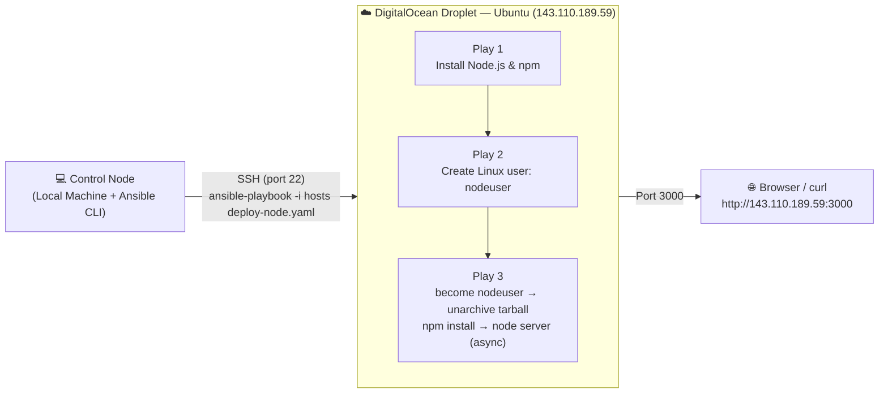
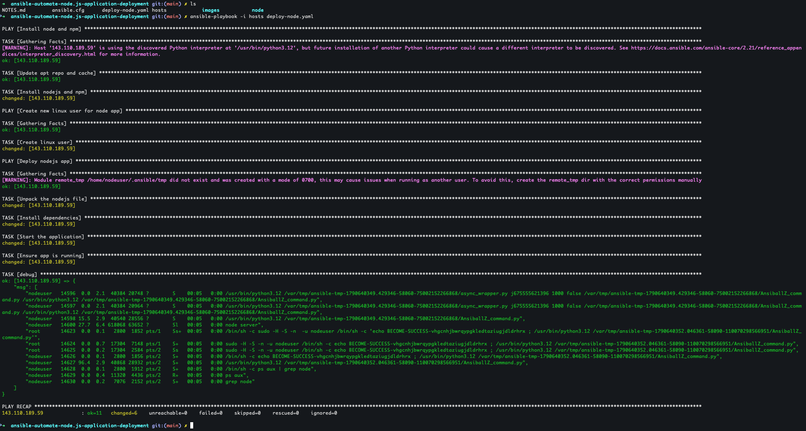
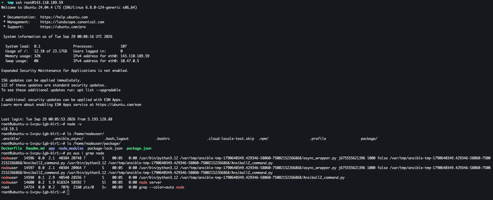

# 🚀 Ansible Automate Node.js application Deployment


**Ansible Automation** is an open-source, agentless IT automation engine that automates provisioning, configuration management, application deployment, and orchestration across large fleets of servers. It describes the *desired state* of a system using simple, human-readable YAML files called **playbooks**, and pushes those changes to managed nodes over standard **SSH** — without requiring any agent, daemon, or extra software installed on the target machines. Because every module is designed to be **idempotent**, running the same automation twice produces the same end state without unintended side effects, which makes Ansible a safe, repeatable and auditable way to manage infrastructure at scale.

## 📖 Overview

This project demonstrates how to use **Ansible** to fully automate the deployment of a **Node.js** application onto a freshly provisioned **DigitalOcean** droplet running **Linux (Ubuntu)**. Instead of manually SSH-ing into the server and running commands one by one, the entire workflow — installing the runtime, creating a dedicated non-root Linux user, shipping the application code, installing its dependencies and starting the process — is packaged into a single, reusable and idempotent Ansible playbook ([deploy-node.yaml](deploy-node.yaml)).

### ✨ Ansible Automation key features

- 🔓 **Agentless architecture** — connects to managed nodes purely over SSH (or WinRM for Windows), so there is nothing to install or maintain on the target servers
- 📝 **Human-readable YAML playbooks** — automation logic is expressed as simple, declarative YAML instead of custom scripting
- 🔁 **Idempotency** — tasks can be run repeatedly and will only change the system when it drifts from the desired state
- 🧩 **Modular building blocks** — reusable **Modules**, **Roles** and **Collections** let automation be composed, shared and version-controlled
- ⚡ **Ad-hoc command execution** — one-off tasks (e.g. `ping`, `shell`, `apt`) can be run instantly across a fleet without writing a full playbook
- 🗂️ **Flexible inventory management** — hosts can be grouped by region, role or environment, with variables applied per host or per group (`group_vars`)
- 🔌 **Extensibility** — custom modules and plugins can extend Ansible's behaviour to fit any infrastructure need
- 🏪 **Ansible Galaxy** — a public registry for discovering and sharing community-built roles and collections
- 🔒 **Secure secrets handling** — sensitive data (passwords, keys, tokens) can be encrypted at rest using **Ansible Vault**
- 🎯 **Orchestration** — multiple plays can target different host groups in a defined order within a single playbook run, exactly as demonstrated in this project

## Demo Project

Ansible Automate Node.js application Deployment

## Technologies used

- Ansible
- Node.js
- DigitalOcean
- Linux

## Project Description

- Create Server on DigitalOcean
- Write Ansible Playbook that installs necessary technologies, creates Linux user for an application and deploys a NodeJS application with that user

## 📁 Repository structure

```text
ansible-automate-node.js-application-deployment/
├── ansible.cfg                # Ansible configuration (default inventory, SSH behaviour)
├── hosts                      # Inventory file - lists the target DigitalOcean droplet
├── deploy-node.yaml           # Main playbook - installs Node.js, creates a user & deploys the app
├── NOTES.md                   # Personal study notes covering the full Ansible learning path
├── README.md                  # This file 📄
├── images/                    # Screenshots captured while running the demo
│   ├── ansible-output-terminal.png
│   └── remote-server-node-app-deployed-terminal.png
└── node/                      # The Node.js application that gets shipped to the server
    ├── Dockerfile              # Optional: containerize the app for local testing
    ├── Readme.md                # Docker build instructions
    ├── package.json             # App metadata & dependencies (express, pino)
    ├── nodejs-app-1.0.0.tgz     # Packaged tarball generated with `npm pack`, deployed by Ansible
    └── app/
        └── server.js            # Express server - responds on port 3000
```

## 🏗️ Architecture overview



- The **control node** is the local machine where Ansible is installed and the playbook is executed from
- The **managed node** is the DigitalOcean droplet, targeted purely through its IP address defined in the [hosts](hosts) inventory file
- Ansible connects over **SSH using a key pair**, requiring **no agent** installed on the droplet
- The playbook is organized into **three sequential plays**, each targeting the same host but responsible for a distinct part of the desired end-state: runtime installation → user provisioning → application deployment
- Once deployed, the Express server listens on **port 3000** and can be reached directly from a browser or `curl`

## 🧭 Implementation Guide

### 1. Prerequisites

Before running this automation, make sure you have the following in place:

- ✅ **Ansible installed** on your local/control machine

  ```bash
  # macOS
  brew install ansible

  # or via pip (Ansible is written in Python)
  pip install ansible
  ```

- ✅ A **DigitalOcean account** with a droplet created (Ubuntu image), see [DigitalOcean's Droplet quickstart](https://docs.digitalocean.com/products/droplets/getting-started/quickstart/)
- ✅ An **SSH key pair** generated locally and added to the droplet at creation time, so Ansible can authenticate without a password

  ```bash
  ssh-keygen -t ed25519 -f ~/.ssh/id_ed25519
  ```

- ✅ Basic familiarity with **Node.js** & **npm**, and the application already available locally (this repo ships a minimal Express app under [node/app/server.js](node/app/server.js))

### 2. Provision the DigitalOcean Droplet

- A single Ubuntu droplet was created from the DigitalOcean control panel, with the local SSH public key (`~/.ssh/id_ed25519.pub`) attached during creation so that key-based authentication is available immediately
- Once created, DigitalOcean assigns a public IPv4 address to the droplet (`143.110.189.59` in this demo) which becomes the target host for every Ansible command below

### 3. Configure the Ansible Inventory & SSH connectivity

The [hosts](hosts) file tells Ansible which server(s) to manage and how to authenticate against them:

```ini
143.110.189.59 ansible_ssh_private_key_file=~/.ssh/id_ed25519 ansible_user=root
```

The [ansible.cfg](ansible.cfg) file sets sane defaults for this project, so the inventory file doesn't need to be passed with `-i` on every command, and SSH host-key prompts are skipped for this ephemeral, single-use droplet:

```ini
[defaults]
host_key_checking = False
inventory = hosts
```

> ⚠️ Disabling `host_key_checking` is convenient for short-lived demo/lab infrastructure, but for production hosts it's best practice to keep host key verification enabled (or pre-seed `~/.ssh/known_hosts` with `ssh-keyscan`) to guard against man-in-the-middle attacks.

### 4. Verify connectivity with an Ansible ad-hoc command

Before writing or running any playbook, connectivity and authentication were validated with the built-in `ping` module:

```bash
ansible all -i hosts -m ping
```

A successful response confirms Ansible can reach the droplet over SSH and that the Python interpreter required by Ansible modules is available on the remote host.

### 5. Package the Node.js application

The Express application ([node/app/server.js](node/app/server.js)) is packaged locally into a distributable tarball using npm's built-in packaging command, matching the `package.json` name/version (`nodejs-app-1.0.0.tgz`):

```bash
cd node
npm pack
```

> 💡 A [Dockerfile](node/Dockerfile) is also included so the same app can optionally be containerized and smoke-tested locally (`docker build -t node-app .`) before being shipped via Ansible — useful for validating the app image independently of the deployment mechanism.

### 6. Write the Ansible Playbook

The core of this project is [deploy-node.yaml](deploy-node.yaml), organized into **three plays** that run in order against the same host:

**Play 1 — Install Node.js & npm**

```yaml
- name: Install node and npm
  # replace with your host IP address
  hosts: 143.110.189.59
  tasks:
    - name: Update apt repo and cache
      apt: update_cache=yes force_apt_get=yes cache_valid_time=3600
    - name: Install nodejs and npm
      apt:
        pkg:
          - nodejs
          - npm
```

**Play 2 — Create a dedicated Linux user for the app**

```yaml
- name: Create new linux user for node app
  # replace with your host IP address
  hosts: 143.110.189.59
  tasks:
    - name: Create linux user
      user:
      # replace with your username
        name: nodeuser
        comment: Node User
        group: admin
```

Running the application under its own non-root user (`nodeuser`) rather than `root` follows the **principle of least privilege**, reducing the blast radius should the application ever be compromised.

**Play 3 — Deploy & run the application as `nodeuser`**

```yaml
- name: Deploy nodejs app
  # replace with your host IP address
  hosts: 143.110.189.59
  become: True
  # replace with your username
  become_user: nodeuser
  tasks:
    - name: Unpack the nodejs file
      unarchive:
        # replace with your folder location
        src: ./node/nodejs-app-1.0.0.tgz
        # replace with your folder location
        dest: /home/nodeuser
    - name: Install dependencies
      npm:
        # replace with your folder location
        path: /home/nodeuser/package
    - name: Start the application
      command:
        # replace with your folder location
        chdir: /home/nodeuser/package/app
        cmd: node server
      async: 1000
      poll: 0
    - name: Ensure app is running
      shell: ps aux | grep node
      register: app_status
    - debug: msg={{app_status.stdout_lines}}
```

Key points about this play:

- `become: True` + `become_user: nodeuser` — every task in this play is privilege-escalated then executed **as `nodeuser`**, instead of the SSH login user (`root`)
- `unarchive` — copies the local tarball to the droplet and extracts it in a single task, defaulting to copying from the **control node** (local machine) to the **remote host**
- `npm` module — installs the application's dependencies declared in `package.json` (`express`, `pino`)
- `command` + `async`/`poll: 0`— starts the Node.js process in the **background** ("fire-and-forget"), so the playbook doesn't hang waiting for a long-running server process to exit
- `shell` + `register` + `debug` — captures the output of `ps aux | grep node` into a variable and prints it to the console, giving immediate visual confirmation that the process is alive

### 7. Run the Playbook

With the inventory, configuration and playbook in place, the full deployment is triggered with a single command:

```bash
ansible-playbook -i hosts deploy-node.yaml
```

Ansible executes each play in order — gathering facts, installing Node.js/npm, creating the `nodeuser` account, unpacking the app, installing dependencies and starting the server — reporting `ok` / `changed` per task along the way:



### 8. Verify the deployment

After the playbook completes, the deployment was verified directly on the droplet over SSH — confirming the Node.js version, the unpacked application folder under `/home/nodeuser/package`, and the running `node server` process:

```bash
ssh root@143.110.189.59
node -v
ls /home/nodeuser/
ls /home/nodeuser/package/
ps aux | grep node
```



With the process confirmed running and listening on port `3000`, the application is also reachable from a browser or `curl` at `http://143.110.189.59:3000`.

## ✅ Final result

By the end of this demo:

- 🖥️ A DigitalOcean Ubuntu droplet was provisioned and made reachable via SSH key authentication
- ⚙️ Ansible was used to remotely install **Node.js** and **npm** with a single idempotent play
- 👤 A dedicated, least-privilege Linux user (`nodeuser`) was created to own and run the application
- 📦 The Node.js/Express application was packaged locally (`npm pack`) and shipped to the server via the `unarchive` module
- 🚀 The application's dependencies were installed and the server process was started in the background and confirmed running (`ps aux | grep node`)
- 🔁 The entire process is **repeatable and idempotent** — the same playbook can be re-run against this or any new droplet to reproduce the exact same environment in minutes, with zero manual SSH steps

This project demonstrates a practical, end-to-end **Configuration Management** and **Application Deployment** workflow using Ansible — from provisioning through to a verified, running application — the same pattern used to manage real production fleets at scale.

## 📚 References

- [Ansible Documentation](https://docs.ansible.com/)
- [Ansible Getting Started Guide](https://docs.ansible.com/ansible/latest/getting_started/index.html)
- [Ansible Modules Index](https://docs.ansible.com/projects/ansible/latest/collections/index_module.html)
- [Ansible Collections](https://docs.ansible.com/ansible/latest/collections/index.html)
- [Ansible Galaxy](https://galaxy.ansible.com/)
- [Ansible `unarchive` module](https://docs.ansible.com/ansible/latest/collections/ansible/builtin/unarchive_module.html)
- [Ansible `npm` module](https://docs.ansible.com/ansible/latest/collections/community/general/npm_module.html)
- [Ansible `user` module](https://docs.ansible.com/ansible/latest/collections/ansible/builtin/user_module.html)
- [Ansible `become` (Privilege Escalation)](https://docs.ansible.com/ansible/latest/playbook_guide/playbooks_privilege_escalation.html)
- [Ansible Asynchronous Actions and Polling](https://docs.ansible.com/ansible/latest/playbook_guide/playbooks_async.html)
- [DigitalOcean Droplets Documentation](https://docs.digitalocean.com/products/droplets/)
- [Node.js Documentation](https://nodejs.org/en/docs)
- [npm-pack Documentation](https://docs.npmjs.com/cli/v10/commands/npm-pack)
- [Express.js](https://expressjs.com/)
